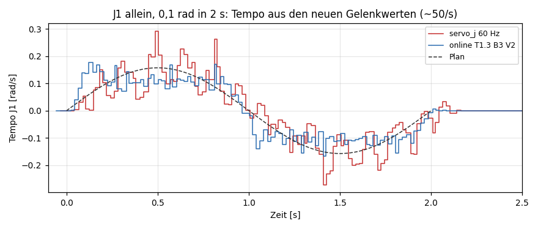
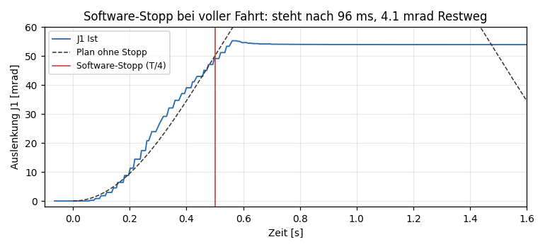
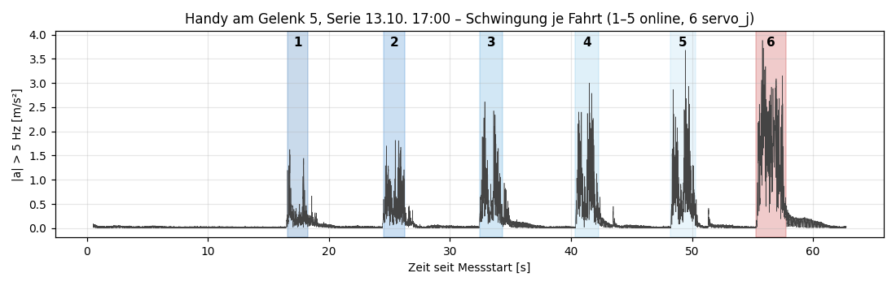
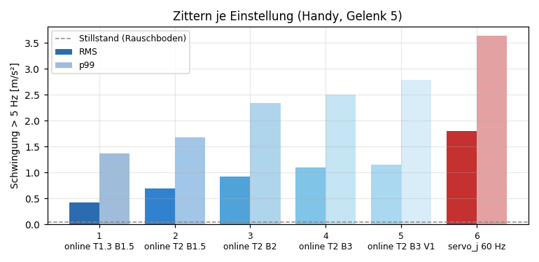
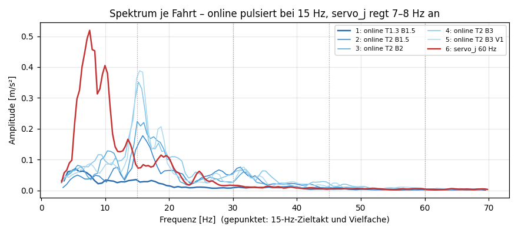
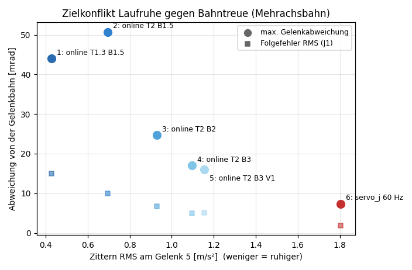
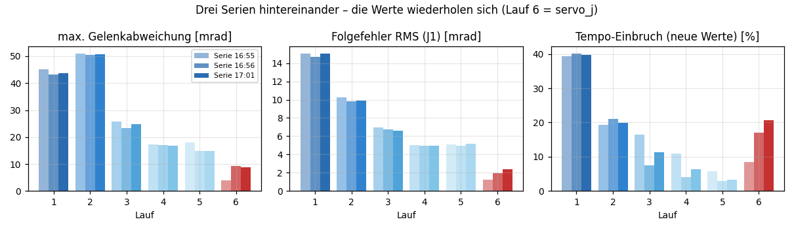

# Zittern an der Anlage — Ursache, Optionen, Entscheidung

Stand **13.10.2026** (Anlagentag mit Messungen). Lebendes Dokument: neue
Messungen und Entscheidungen werden unten angehängt, nicht überschrieben.

Zweck: festhalten, **was** das Problem ist, **warum** es auftritt, **welche
Wege** es gibt (mit Vor- und Nachteilen), **was gemessen** wurde und **warum**
wir uns fürs Erste für `movelinear_online` entschieden haben. Alle Zahlen sind
aus den Rohdaten in `Berichte/` nachrechenbar (Anhang E).

---

## 0. Kurzfassung

* **Problem:** Der LARA 5 zittert an der realen Anlage, sobald er über
  `servo_j` die Aufnahmebahnen fährt. Das Objekt rutschte, die Kamerastange
  schwang (05.10.). In der VM ist davon nichts zu sehen.
* **Ursache:** Wir senden `servo_j` mit **60 Hz**. Neura rechnet `servo_j` als
  **1-kHz-Strom**. Die Steuerung fährt jeden 60-Hz-Sollwert an und wartet auf
  den nächsten — eine **Treppe**, die Arm und Aufbau anregt (gemessen: starke
  Schwingung bei **7–8 Hz**).
* **Gemessen (13.10.):** Mit `movelinear_online` (Steuerung interpoliert
  selbst, wir schicken 15 Ziele/s) sinkt das Zittern am Gelenk 5 von
  **1,80 m/s²** (servo_j) auf **0,43 m/s²** (RMS, −76 %). Der Preis ist
  Bahntreue: unterwegs bis ~44 mrad Gelenkabweichung statt ~7 mrad.
* **Entscheidung fürs Erste:** Ausführung über `movelinear_online` mit
  **Vorlauf 2 Takte, Tempo ×1,3, Beschleunigung ×1,5, 15 Ziele/s** — gleich
  für Aufnahme und Inferenz. `servo_j` bleibt als Option. Abbrüche laufen
  über den Software-Stopp des Adapters (hält in ~100 ms), nicht über
  `stop_movelinear_online()` (bremst nicht).
* **Nicht gewählt:** Override senken (verfälscht die Daten), höhere
  `servo_j`-Rate (der Laptop schafft es über neurapy nicht), Bahnpuffer
  `move_trajectory` (fehlt in v5.0.8). Die eigentliche Herstellerlösung —
  1 kHz über die C++/DDS-API — bleibt als späterer Weg offen.

---

## 1. Das Problem

| | |
|---|---|
| Wann | Anlagentag 05.10.2026, Trockenläufe der Aufnahme (`pick_to_station`) |
| Was | Arm zittert sichtbar und hörbar; Objekt rutscht im Greifer, die Kamerastange schwingt |
| Was es **nicht** war | Takt und Latenzen wurden eingehalten (`servo_j` ~4,7 ms je Aufruf, Bahn lief in der geplanten Zeit, Zeitfaktor 1,00) |
| Was nicht half | Langsameres Planer-Tempo (nur wenig Wirkung) |
| Warum es zählt | Zittern bewegt das Objekt und die Kamera — beides landet in den Trainingsdaten (Bild **und** Zustand). Ein Datensatz mit Zittern lehrt die Policy das Zittern mit. |

Das ist ein **anderes** Problem als das „Ruckeln“ vom 01.–03.10. in der VM:
Dort kamen Sollwerte zu spät, weil der Laptop gedrosselt lief (Netzteil,
Energiemodus; `Laptop-Inbetriebnahme-Befunde.md` 7.1). An der Anlage am 05.10.
und 13.10. war der Takt sauber — es zittert trotzdem.

---

## 2. Warum es auftritt

### 2.1 Wie wir den Arm ansteuern

```
Planer/Policy  ──15 Hz──►  ServoInterpolator (bc/servo.py)  ──60 Hz──►  servo_j  ──►  Steuerung
   (Ziel je Takt)          linear, 4 Zwischenschritte je Takt        (RPC je Aufruf ~4,7 ms)
```

* Aufnahme und Inferenz arbeiten mit **15 Hz** (festgelegt, `CONTROL_RATE_HZ`).
* Dazwischen interpoliert `bc/servo.py` linear auf **60 Hz** und schickt
  jeden Zwischenpunkt per `servo_j`.
* Laut Neura-Doku (`neurapy.pdf`, C++-API) ist `servo_j`/`servo_x` für einen
  **zyklischen 1-kHz-Strom** gedacht; das Beispiel sendet mit
  `time.sleep(0.001)`, ein Interpolator (Ruckig) läuft im Client.

### 2.2 Die Treppe

Bekommt die Steuerung nur alle 16,7 ms einen neuen Sollwert, fährt sie ihn an
und **wartet** dann (VM-Messung 15.09.: Stop-and-go innerhalb jedes Takts).
Aus einer glatten Bahn wird eine Treppe mit 60 Stufen pro Sekunde. Jede Stufe
ist ein kleiner Beschleunigungs- und Bremsstoß.

Die Handy-Messung vom 13.10. zeigt, wo diese Stöße landen: **nicht** bei 60 Hz,
sondern als starke Schwingung bei **7–8 Hz** — offenbar eine Eigenfrequenz von
Arm, mobiler Plattform und Aufbau, die von den Stößen angeregt wird
(Bild 3, rote Kurve).

### 2.3 Warum man es in der VM nicht sieht

1. **Keine Mechanik.** Die VM rechnet Sollwerte; da schwingt nichts.
2. **Zu wenige Messwerte.** VM **und** Anlage liefern über neurapy nur
   **~50 neue Gelenkwerte pro Sekunde**, egal wie schnell man liest (am 13.10.:
   ~190 Lesungen/s, davon ~70 % Wiederholungen). 60-Hz-Stufen und das Zittern
   sind damit aus den Gelenkwinkeln **nicht messbar** — nur mit einem Sensor
   von außen (Handy) oder nach Gehör/Video.
3. **15-Hz-Aufnahmen** lösen es ohnehin nicht auf.

### 2.4 Was es nicht ist

| Vermutung | Befund |
|---|---|
| Rechner hält den Takt nicht | An der Anlage gehalten (0–4 Überläufe je Fahrt mit 60 Hz). Das war das Problem 01.–03.10. in der VM auf dem gedrosselten Laptop. |
| Zu schnelles Planer-Tempo | Langsamer half kaum (05.10.). Die Stufen bleiben, nur kleiner. |
| Override | Override 0,2 sieht ruhiger aus, weil der Arm **4–10° hinterherläuft** (VM 03.10.: Schleppfehler-Median 0,078 rad). Die Daten zeigen dann eine Bahn, die nie gefahren wurde. Kein Ausweg. |
| IK / Konfigurationswechsel | Nein (Mehrachstests 13.10.: Arm kehrt immer auf 0,2–1,3 mrad in die Startstellung zurück). |

---

## 3. Lösungswege mit Vor- und Nachteilen

| | Weg | Idee | Vorteile | Nachteile | Stand 13.10. |
|---|---|---|---|---|---|
| A | Planer-Tempo senken | kleinere Stufen | nichts zu bauen, je Lauf einstellbar (GUI) | wirkt kaum, Episoden länger, Tempo wird mitgelernt | **kaum Wirkung** (05.10.) |
| B | Override senken | Steuerung glättet | nichts zu bauen | Arm folgt nicht, Daten falsch; Inferenz müsste denselben Override fahren | **verworfen** |
| C | `servo_j` 90/120 Hz | kürzere Stufen | gleicher Befehl, kleine Änderung | Laptop schafft es über neurapy nicht: 88 bzw. 246 Takt-Überläufe, Bahn 1,25–1,51× gestreckt (je Aufruf eine TCP-Verbindung) | **verworfen** (mit neurapy) |
| D | Rollender Puffer `move_trajectory` | 1 Aufruf je Takt trägt 200–300 ms Bahn, Steuerung interpoliert mit 1 kHz | ideal: glatt **und** bahntreu | Befehl **fehlt** in v5.0.8 (nur in Doku-Beispielen) | **nicht möglich** |
| E | **`movelinear_online`** | 1 kartesisches Ziel je Takt + Höchstwerte v/a, Steuerung plant selbst | läuft an der Anlage; Zittern −76 %; 0 Überläufe; Leerlauf und Stopp beherrschbar | Zielkonflikt Laufruhe ↔ Bahntreue (§ 5.3); Ausführung kartesisch (Action bleibt Gelenkraum); `stop_movelinear_online` bremst nicht; in der VM (alpha.102) nicht ausführbar | **gewählt** (fürs Erste) |
| F | 1 kHz über Neura C++-API (Fast-DDS, `/command/servoj`) | so wie vom Hersteller gedacht | eigentliche Lösung, glatt und bahntreu | nur Linux (WSL2 auf dem Laptop ungetestet), eigener Client, großer Aufwand, Sicherheitslogik neu | **offen**, späterer Weg |
| G | Nur die 15-Hz-Bahn glätten | weniger Ruck im Plan | billig | Treppe bleibt, Anregung bleibt | wenig Wirkung (Modellrechnung 05.10.) |
| H | Aufbau versteifen (Kamerastange) | weniger Mitschwingen | wirkt unabhängig von der Software | bekämpft die Folge, nicht die Ursache | parallel sinnvoll |

---

## 4. Durchführung der Tests (13.10.2026)

Alle Fahrten an der realen Anlage (`is_robot_in_simulation() = False`,
Steuerung `v5.0.8`, Tool `ZimmerLWR50`, Override 1,0), Laptop `LAPPI` am
Netzteil. Werkzeug: `tools/check_trajectory_buffer.py` (GUI: Systemcheck →
*Bahnpuffer testen*), Arm vorher am Pendant in eine freie Pose gefahren,
jede Fahrt mit Freigabewort `ANLAGE`.

**Testbahnen** (immer um die aktuelle Stellung, hin und zurück, Kosinus-Profil):

| Bahn | Bewegung | Spitze |
|---|---|---|
| J1 klein | nur Gelenk 1, 0,05 rad in 4 s | 0,04 rad/s |
| J1 | nur Gelenk 1, 0,1 rad in 2 s | 0,16 rad/s, TCP 0,09 m/s |
| 6 Achsen | alle Gelenke, Richtung `1,-0.5,-0.5,0.8,-0.8,1`, 0,1 rad in 2 s; TCP steigt bis 6,8 cm, sinkt nie | TCP 0,18 m/s, Drehung 0,42 rad/s — schneller als die Aufnahme (0,15 m/s) |

**Messgrößen** (Erklärung in Anhang A): Welligkeit, Tempo-Einbruch und
Tempo p5 aus den **neuen** Gelenkwerten (~50/s, also nur bis ~25 Hz
auflösbar); Verzug und Folgefehler gegen die geplante Bahn; größte
Gelenkabweichung über alle 6 Gelenke; Takt-Überläufe des Senders.
**Das Zittern selbst** misst nur das Handy (§ 4.6).

### 4.1 Puffer-Befehle (nur lesen)

`move_trajectory` **fehlt** (210 Funktionen). Vorhanden: `movelinear_online`,
`stop_movelinear_online`, `servo_x`, `plan_move_joint`/`executor`. → Weg D entfällt.

### 4.2 `servo_j` mit 60, 90, 120 Hz (J1 klein)

| Rate | Takt-Überläufe | Bahn gestreckt | Verzug |
|---|---|---|---|
| 60 Hz | 4 | nein | 76 ms |
| 90 Hz | 88 | 1,25× | 396 ms |
| 120 Hz | 246 | 1,51× | 600 ms |

→ Mehr als 60 Hz hält der Laptop über neurapy nicht. Weg C entfällt.

### 4.3 `movelinear_online` mit Gelenk 1

* Fährt an der Anlage (in der VM: angenommen, aber keine Bewegung).
* Gleiche Bahn J1 (0,1 rad/2 s): `servo_j` **zittert deutlich** (Gehör/Sicht),
  `online` **höchstens mild**. Messwerte: Tempo-Einbruch 15 % gegen 0–2 %,
  Tempo p5 0,34 gegen 0,57–0,60 (Bild 6).
* **Vorlauf** 1 / 2 / 3 Takte: Glätte gleich; Vorlauf 2 hat Verzug ≈ 0
  (−6…−8 ms), Vorlauf 3 eilt vor (−50 ms).
* **Beschleunigung** ×1,5 statt ×3: etwas ruhiger nach Gehör, +25 ms Verzug.



*Bild 6 — Tempo von J1 aus den neuen Gelenkwerten. servo_j (rot) springt
zwischen Stillstand und Überschwingen, online (blau) folgt dem Plan ruhiger.
Die 50-Hz-Quelle glättet beides; die 60-Hz-Treppe selbst ist hier nicht
sichtbar.*

### 4.4 Stopps mit `movelinear_online` (J1, Abbruch bei voller Fahrt)

| Abbruch | Arm steht nach | Weg nach dem Abbruch | Urteil |
|---|---|---|---|
| Python sendet nichts mehr (Leerlauf) | 320 ms | 23 mrad = bis zum letzten Ziel, nichts darüber | ✅ ein ausgefallenes Programm fährt höchstens den Vorlauf zu Ende |
| `stop_movelinear_online()` | 308 ms | 22,9 von 23,1 mrad Restweg | ⚠ **bremst nicht** — nur zum normalen Beenden |
| Software-Stopp des Adapters (`emergency_stop` → `stop()`) | **96 ms** | **4,1 mrad** | ✅ echter Stopp, wirkt abrupt; neu initialisieren ohne Pendant |



*Bild 7 — Software-Stopp bei T/4: der Arm steht nach ~0,1 s.*

> **Datenverlust:** Die Rohdaten von Leerlauf und `stop_movelinear_online`
> (16:29) wurden vom nächsten Lauf in derselben Minute überschrieben; die
> Zahlen oben stammen aus der Konsolenausgabe. Behoben im Werkzeug
> (Berichtsname mit Sekunden, wenn die Minute schon belegt ist).

### 4.5 Sechs Achsen — IK und Höchstwerte

Frage: Löst die Steuerung kartesische Ziele anders auf als unsere Gelenkbahn
(anderer IK-Zweig)?

* **Kein IK-Problem:** Der Arm kehrt in jedem Lauf auf 0,2–1,3 mrad in die
  Startstellung zurück. Ein anderer Zweig wäre ein bleibender Sprung um
  Zehntel-Radiant.
* Die Abweichungen unterwegs hängen an den **Höchstwerten**:
  * Beschleunigung ×1,5 → J4/J5 überschwingen (bis 44–51 mrad)
  * Beschleunigung ×3 → J2/J4/J5 fast exakt, J1/J3/J6 fahren ~12 % zu wenig Hub
  * Tempo ×2 → alle Gelenke ~1,0 Hub, max. 17 mrad, RMS 5 mrad
* Aber: Tempo ×2 mit Beschleunigung ×3 ist **hörbar lauter**. Vorlauf 1
  statt 2 und **30 statt 15 Ziele/s** ändern daran nichts.

### 4.6 Serie mit Handy-Messung (Kern des Tages)

Dieselbe 6-Achsen-Bahn, sechs Läufe am Stück, dreimal hintereinander (16:55,
16:56, 17:00). Bei der letzten Serie war ein Handy (Samsung SM-S921B, phyphox
„Beschleunigung mit g“, 500 Hz) am Unterarm (Gelenk 5) festgeklebt.
Auswertung: Betrag der Beschleunigung über 5 Hz (Fahrtbewegung und Lage des
Handys liegen darunter), Fahrten automatisch aus der Lageänderung erkannt —
sie fallen auf die Sekunde mit den `LOS`-Zeiten des Werkzeugs zusammen.

| Lauf | Einstellung | Zittern RMS | p99 | 15-Hz-Anteil | stärkste Frequenz | max. Gelenkabw. | Folgefehler RMS |
|---|---|---|---|---|---|---|---|
| 1 | online Tempo ×1,3, Beschl. ×1,5, Vorlauf 2 | **0,43 m/s²** | 1,36 | 0,07 | 6 Hz | 44 mrad | 15 mrad |
| 2 | online ×2 / ×1,5 / 2 | 0,69 | 1,68 | 0,34 | **15 Hz** | 51 | 10 |
| 3 | online ×2 / ×2 / 2 | 0,93 | 2,35 | 0,45 | **15 Hz** | 25 | 7 |
| 4 | online ×2 / ×3 / 2 | 1,10 | 2,50 | 0,71 | **15 Hz** | 17 | 5 |
| 5 | online ×2 / ×3 / 1 | 1,15 | 2,79 | 0,82 | **15 Hz** | 15 | 5 |
| 6 | **servo_j 60 Hz** (bisher) | **1,80 m/s²** | 3,63 | 0,31 | **8 Hz** | 7 | 2 |

Stillstand (Rauschboden): 0,04 m/s². Gelenkwerte: Mittel der drei Serien.



*Bild 1 — Schwingung über 5 Hz während der ganzen Serie. Lauf 6 (servo_j)
schwingt am stärksten und am längsten.*



*Bild 2 — Zittern je Einstellung. online steigt mit Tempo- und
Beschleunigungsgrenze, bleibt aber in jeder Einstellung unter servo_j.*



*Bild 3 — Spektren. servo_j (rot) regt 7–8 Hz an (Eigenschwingung des
Aufbaus), online mit großzügigen Höchstwerten pulsiert im **15-Hz-Zieltakt**.
Lauf 1 hat als einziger keine 15-Hz-Spitze.*



*Bild 4 — Je ruhiger, desto weniger bahntreu. servo_j ist am bahntreuesten
und am lautesten.*



*Bild 5 — Die drei Serien liefern fast dieselben Gelenkwerte; die Ergebnisse
sind keine Zufallstreffer. (Der Tempo-Einbruch von servo_j wirkt klein, weil
die 50-Hz-Quelle die 60-Hz-Stufen nicht auflöst.)*

---

## 5. Erkenntnisse

1. **Ursache bestätigt:** Die Treppe aus 60-Hz-`servo_j` regt eine
   Eigenschwingung bei 7–8 Hz an. Mit `movelinear_online` ist das Zittern
   je nach Einstellung 1,6- bis 4-mal schwächer.
2. **Über die Gelenkwinkel nicht messbar:** Die Steuerung liefert nur ~50 neue
   Werte/s. Für Laufruhe zählen Handy-Sensor, Gehör und Video — die
   Kennzahlen des Werkzeugs zeigen nur Tendenzen.
3. **Zielkonflikt bei `movelinear_online`:** Mit 15 Zielen/s entscheidet die
   **Beschleunigungsgrenze**:
   * knapp (×1,5) → die Steuerung kommt nicht dazu, jedes Ziel anzufahren und
     abzubremsen, sie fährt durch — ruhig, aber sie kürzt ab und läuft nach;
   * großzügig (×3, Tempo ×2) → sie fährt jedes Ziel an und bremst — bahntreu,
     aber hörbar im 15-Hz-Takt.
   Vorlauf und Zielrate (15/30 Hz) verschieben das nicht.
4. **Stopps:** `stop_movelinear_online()` ist kein Stopp; der Software-Stopp
   des Adapters hält in ~100 ms. Fällt das Programm aus, fährt der Arm nur bis
   zum letzten Ziel (Vorlauf).
5. **Kein IK-Risiko** auf den getesteten Bahnen.
6. **Laptop-Grenze:** Über neurapy sind mehr als 60 `servo_j`/s nicht drin
   (eine TCP-Verbindung je Aufruf).

---

## 6. Entscheidung und Vorgehen (fürs Erste)

**Ausführung über `movelinear_online`**, Startwerte:

| Parameter | Wert | Grund |
|---|---|---|
| Ziele je Sekunde | 15 (eins je Takt) | 30 brachte nichts, kostet doppelt so viele Aufrufe |
| Vorlauf | 2 Takte (133 ms) | Verzug ≈ 0 bei J1; 3 eilt vor |
| Tempo-Grenze | ×1,3 der Bahnspitze | ruhigste Einstellung (keine 15-Hz-Spitze) |
| Beschleunigungsgrenze | ×1,5 der Bahnspitze | dito |

**Warum diese Einstellung trotz Bahnabweichung:**

* Das Zittern bewegt Objekt und Kamera — das verdirbt Bild und Zustand.
  Eine Bahnabweichung dagegen wird **ehrlich aufgezeichnet**:
  `observation.state` ist der gemessene Zustand, die Action bleibt die ideale
  Gelenkbahn (t+1). Die Policy lernt daraus Korrekturen, wie beim Rauschen.
* Die 44 mrad stammen von einer Testbahn, die schneller ist als die
  Aufnahme (0,18 m/s, 0,42 rad/s Drehung, Umkehr bei voller Auslenkung). Die
  echten Bahnen fahren an jedem Wegpunkt sanft an und bremsen.
* Abstand zur Abbruchgrenze des Recorders (0,30 rad Schleppfehler) bleibt groß.
* Lauf 3 (Tempo ×2, Beschl. ×2: 25 mrad, Zittern 0,93) ist der Ausweichpunkt,
  falls die Bahnabweichung an echten Bahnen stört.

**Regeln für die Umsetzung:**

1. **Aufnahme und Inferenz identisch** — die Ausführungsart und ihre Werte
   stehen in den Metadaten jeder Episode, der Export verbietet Mischungen,
   `infer.py` übernimmt sie aus der Aufnahme.
2. **Action bleibt im Gelenkraum.** Das Ziel für `movelinear_online` ist
   FK(Gelenkziel) — die Ausführung ist kartesisch, das Label nicht.
3. **Abbrüche** (Schutzstopp, Schleppfehler, Abbrechen-Knopf) über den
   Software-Stopp des Adapters; normales Ende über `stop_movelinear_online()`.
4. **`servo_j` bleibt als Option** (VM, Vergleich). In der VM (alpha.102)
   fährt `movelinear_online` nicht — dort läuft weiter `servo_j`.
5. Kein neues Datenschema; `SCHEMA_VERSION` bleibt.

**Status:** Freigabe durch den Anwender am 13.10.2026. Umsetzung siehe § 8.

---

## 7. Offen / nächste Messungen

| Punkt | Wie | Wann |
|---|---|---|
| Startwerte an einer **echten Aufnahmebahn** bestätigen | Aufnahme mit `online`, Rauschen 0, Handy an Gelenk 5 **und** an der Kamerastange, Video | nächster Anlagentag |
| Was kommt an der Kamera an? | zweites Handy an der Kamerastange, gleichzeitig | nächster Anlagentag |
| Kompromiss Lauf 3 gegen Lauf 1 an echten Bahnen | Serie-Werkzeug mit den Werten der Aufnahme | nächster Anlagentag |
| Lücke im Zustand | in zwei Läufen mit Vorlauf 1 kam einmal ~110 ms kein neuer Gelenkwert — in einer Aufnahme ein verspäteter Zustand | in der VM / am PC beobachten |
| VM-Abbild mit `v5.0.8` | würde `movelinear_online` in der VM fahrbar machen | beim Betreuer/Neura nachfragen |
| Weg F (1 kHz über DDS) | `read_joint_state` aus der deb in WSL2 testen, nur lesend | wenn E nicht reicht |
| Aufbau versteifen | Kamerastange | Gruppe |

---

## 8. Umsetzung (13.10.2026)

| Wo | Was |
|---|---|
| `bc/config.py` | `EXECUTION_MODE = "auto"`, `ONLINE_LEAD_STEPS = 2`, `ONLINE_SPEED_FACTOR = 1.3`, `ONLINE_ACCEL_FACTOR = 1.5`, `ONLINE_VERIFIED = False`, `ONLINE_SETTLE_S = 1.0` |
| `bc/execution.py` (neu) | Modus `auto` → `online` nur an der realen Anlage, sonst `servo_j`; Höchstwerte aus dem **Planer-Tempo** (Transit, PTP, Rampe) statt aus einer konkreten Bahn — so rechnen Aufnahme und Inferenz mit denselben Zahlen; Metadaten-Eintrag `execution` |
| `bc/ports.py`, Adapter | `online_j(Gelenkziel, v, a)` und `stop_online()`. Neura: gleiche Sperren wie `servo_j` (Bewegungsfreigabe, Servo-Interface, Stopp, ServoGuard auf dem Gelenkziel), dann FK → `movelinear_online`. SimRobot: Nachbildung für Logiktests (keine Zahlen). `emergency_stop()` ruft wie bisher erst `stop()`, dann `stop_movelinear_online()` |
| `bc/recorder.py` | Zweig `online`: je Takt **ein** `online_j` mit dem Ziel *i + Vorlauf* (am Bahnende festgehalten), am Ende Ausrollen bis zum letzten Ziel (≤ 1 s), dann `stop_online()`. `aux.joints_command` bleibt die Sollstellung des Takts *i*. Schleppfehler-Abbruch unverändert |
| `apps/record.py`, GUI | `--ausfuehrung auto|servo_j|online`, `--online-vorlauf/-tempo/-beschl`; Aufnahme-Reiter: Auswahl **Ausführung** (Standard `auto`) |
| `bc/lerobot_io.py`, `apps/train.py` | `execution/mode`, `…/lead_steps`, `…/speed_factor`, `…/accel_factor` sind Konsistenzschlüssel — der Export verweigert gemischte Datensätze; `bc_policy.json` trägt sie weiter |
| `bc/policy.py` | `lookahead(k)` in `ChunkEnsembler` und `ChunkExecutor`: die gemittelte Action *k* Takte voraus |
| `apps/infer.py` | Ausführung = die der Aufnahme (Pflicht; Abweichung → Abbruch). `online`: je Takt `online_j(lookahead(Vorlauf − 1))` — dasselbe Ziel wie in der Aufnahme —, Ende über `stop_online()`, Abbrüche über `emergency_stop()` |
| Tests | `tests/test_execution.py` (neu), Recorder (Vorlauf, ein Aufruf je Takt, Stopp → verworfen), Policy (`lookahead`), Export (kein Mischen), GUI. Gesamt 321/321 |

**In der VM** bleibt es bei `servo_j` (`auto`), weil `movelinear_online` dort
nicht fährt. Wer in der VM ausdrücklich `online` wählt, bekommt eine Warnung;
der Recorder bricht dann mit „Arm folgt nicht“ ab.

**Noch nicht an der Anlage gelaufen:** Aufnahme und Inferenz mit `online`.
Erster Schritt beim nächsten Termin (§ 7): eine Referenzfahrt ohne Rauschen
mit Handy am Gelenk 5 und an der Kamerastange, danach *Aufnahmen bewerten*.
`ONLINE_VERIFIED` bleibt bis dahin `False`.

---

## Anhang

### A. Messgrößen

| Größe | Bedeutung | Grenze der Aussage |
|---|---|---|
| **Zittern RMS / p99** | Betrag der Handy-Beschleunigung über 5 Hz während der Fahrt | direktes Maß; nur Lauf gegen Lauf an derselben Befestigung vergleichen |
| Welligkeit | RMS(v_ist − v_plan) / v_max, aus den neuen Gelenkwerten | 50-Hz-Quelle: löst nur bis ~25 Hz auf |
| Tempo-Einbruch | Anteil der Fahrzeit unter 50 % des Plantempos | zählt bei online auch Nachlaufen/Abkürzen |
| Tempo p5 | 5-%-Quantil von v_ist / v_plan in Fahrt | dito |
| Verzug | Zeitversatz, mit dem der Arm der Planung am besten folgt (J1) | positiv = hinterher |
| Folgefehler RMS | Abstand zur um den Verzug versetzten Planung (J1) | |
| max. Gelenkabweichung | größte Abweichung **eines** Gelenks von der Gelenkbahn (alle 6) | zeigt Abkürzen/Überschwingen, IK-Wechsel |
| Takt-Überläufe | Sollwerte, die zu spät gesendet wurden | Laptop/Steuerung |

### B. Handy-Messung, je Lauf

Datei: `Berichte/2026-10-13_17-00_Handy-Beschleunigung_Gelenk5.xlsx`
(phyphox 1.2.1, Samsung SM-S921B, 500 Hz, Start 17:00:01.244). Amplituden in
m/s² (Spektralanteil ±1,5 Hz um 15/30/60 Hz).

| Lauf | Beginn (Handy) | Zittern RMS | p99 | 15 Hz | 30 Hz | 60 Hz | stärkste Frequenz |
|---|---|---|---|---|---|---|---|
| 1: online T1.3 B1.5 | 17:00:17 | 0.43 | 1.36 | 0.07 | 0.02 | 0.005 | 5.9 Hz |
| 2: online T2 B1.5 | 17:00:25 | 0.69 | 1.68 | 0.34 | 0.14 | 0.011 | 15.3 Hz |
| 3: online T2 B2 | 17:00:33 | 0.93 | 2.35 | 0.45 | 0.08 | 0.010 | 15.5 Hz |
| 4: online T2 B3 | 17:00:41 | 1.10 | 2.50 | 0.71 | 0.14 | 0.013 | 15.7 Hz |
| 5: online T2 B3 V1 | 17:00:49 | 1.15 | 2.79 | 0.82 | 0.11 | 0.016 | 15.4 Hz |
| 6: servo_j 60 Hz | 17:00:56 | 1.80 | 3.63 | 0.31 | 0.04 | 0.013 | 8.0 Hz |

### C. Alle Fahrten an der Anlage am 13.10.

T = Tempo-Grenze, B = Beschleunigungsgrenze (je als Vielfaches der
Bahnspitze), V = Vorlauf in 15-Hz-Takten. Die Stopp-Tests von 16:29 fehlen
(überschrieben, § 4.4).

| Zeit | Test | Bahn | Verfahren | Einstellung | Welligkeit | Einbruch | Tempo p5 | Verzug | Folgefehler RMS | max. Gelenkabw. | Takt-Überl. | Bericht |
|---|---|---|---|---|---|---|---|---|---|---|---|---|
| 15:54 | `referenz` | J1, 0.05 rad/4s | servo_j 60 Hz | – | 43.3 % | 23.2 % | 0.17 | 76 ms | 0.4 mrad | – | 4 | `2026-10-13_15-54` |
| 15:54 | `referenz_90` | J1, 0.05 rad/4s | servo_j 90 Hz | – | 48.9 % | 32.4 % | 0.00 | 396 ms | 6.1 mrad | – | 88 | `2026-10-13_15-54` |
| 15:54 | `referenz_120` | J1, 0.05 rad/4s | servo_j 120 Hz | – | 49.9 % | 46.4 % | -0.04 | 600 ms | 14.6 mrad | – | 246 | `2026-10-13_15-54` |
| 15:54 | `online` | J1, 0.05 rad/4s | online | T1.3 B3.0 V1 | 28.4 % | 3.7 % | 0.60 | 182 ms | 3.0 mrad | – | 0 | `2026-10-13_15-54` |
| 16:05 | `online` | J1, 0.10 rad/2s | online | T1.3 B3.0 V2 | 27.8 % | 2.0 % | 0.60 | -8 ms | 6.3 mrad | – | 0 | `2026-10-13_16-05` |
| 16:06 | `online` | J1, 0.10 rad/2s | online | T1.3 B3.0 V3 | 28.9 % | 2.0 % | 0.56 | -50 ms | 6.9 mrad | – | 0 | `2026-10-13_16-06` |
| 16:10 | `referenz` | J1, 0.10 rad/2s | servo_j 60 Hz | – | 34.6 % | 14.6 % | 0.34 | 58 ms | 1.5 mrad | – | 1 | `2026-10-13_16-10` |
| 16:11 | `online` | J1, 0.10 rad/2s | online | T1.3 B3.0 V2 | 28.5 % | 0.0 % | 0.57 | -6 ms | 6.1 mrad | – | 0 | `2026-10-13_16-11` |
| 16:13 | `online` | J1, 0.10 rad/2s | online | T1.3 B1.5 V2 | 26.9 % | 0.0 % | 0.61 | 20 ms | 6.0 mrad | – | 0 | `2026-10-13_16-13` |
| 16:14 | `online` | J1, 0.10 rad/2s | online | T1.3 B1.5 V2 | 26.5 % | 5.1 % | 0.56 | 18 ms | 6.2 mrad | – | 0 | `2026-10-13_16-14` |
| 16:15 | `online` | J1, 0.10 rad/2s | online | T1.3 B3.0 V2 | 29.3 % | 1.8 % | 0.57 | -8 ms | 6.1 mrad | – | 0 | `2026-10-13_16-15` |
| 16:29 | `online_mehrachs` | 6 Achsen, 0.10 rad/2s | online | T1.3 B1.5 V2 | 50.7 % | 42.7 % | 0.11 | 34 ms | 15.0 mrad | 43.6 mrad (J5) | 0 | `2026-10-13_16-29` |
| 16:30 | `online_notstopp` | J1, 0.10 rad/2s | online | T1.3 B1.5 V2 | 64.9 % | 69.4 % | -0.05 | -48 ms | 30.6 mrad | – | 0 | `2026-10-13_16-30` |
| 16:34 | `online_mehrachs` | 6 Achsen, 0.10 rad/2.5s | online | T1.3 B1.5 V2 | 48.1 % | 36.8 % | 0.13 | 78 ms | 15.4 mrad | 38.1 mrad (J5) | 0 | `2026-10-13_16-34` |
| 16:35 | `online_mehrachs` | 6 Achsen, 0.10 rad/2s | online | T1.3 B3.0 V2 | 46.3 % | 37.3 % | 0.27 | 64 ms | 14.6 mrad | 29.7 mrad (J1) | 0 | `2026-10-13_16-35` |
| 16:36 | `online_mehrachs` | 6 Achsen, 0.10 rad/2s | online | T1.3 B3.0 V2 | 43.3 % | 33.1 % | 0.33 | 78 ms | 14.0 mrad | 27.9 mrad (J1) | 0 | `2026-10-13_16-36` |
| 16:38 | `online_mehrachs` | 6 Achsen, 0.10 rad/2s | online | T2.0 B3.0 V2 | 31.5 % | 7.4 % | 0.48 | -64 ms | 5.0 mrad | 17.6 mrad (J5) | 0 | `2026-10-13_16-38` |
| 16:40 | `online_mehrachs` | 6 Achsen, 0.10 rad/2s | online | T2.0 B3.0 V1 | 32.5 % | 10.6 % | 0.54 | -6 ms | 5.0 mrad | 17.2 mrad (J5) | 0 | `2026-10-13_16-40` |
| 16:43 | `online_mehrachs` | 6 Achsen, 0.10 rad/2s | online | T2.0 B1.5 V2 | 37.3 % | 19.7 % | 0.16 | -76 ms | 9.9 mrad | 51.4 mrad (J5) | 0 | `2026-10-13_16-43` |
| 16:47 | `online_mehrachs` | 6 Achsen, 0.10 rad/2s | online | T2.0 B3.0 V1 30 Hz | 31.9 % | 11.4 % | 0.53 | 48 ms | 5.1 mrad | 15.9 mrad (J6) | 0 | `2026-10-13_16-47` |
| 16:55 | `serie_1` | 6 Achsen, 0.10 rad/2s | online | T1.3 B1.5 V2 | 50.2 % | 39.3 % | 0.12 | 26 ms | 15.1 mrad | 45.1 mrad (J5) | 0 | `2026-10-13_16-55` |
| 16:55 | `serie_2` | 6 Achsen, 0.10 rad/2s | online | T2.0 B1.5 V2 | 39.0 % | 19.4 % | 0.17 | -70 ms | 10.3 mrad | 51.0 mrad (J5) | 0 | `2026-10-13_16-55` |
| 16:55 | `serie_3` | 6 Achsen, 0.10 rad/2s | online | T2.0 B2.0 V2 | 35.5 % | 16.4 % | 0.42 | -58 ms | 7.0 mrad | 25.7 mrad (J5) | 0 | `2026-10-13_16-55` |
| 16:55 | `serie_4` | 6 Achsen, 0.10 rad/2s | online | T2.0 B3.0 V2 | 31.2 % | 11.0 % | 0.47 | -66 ms | 5.0 mrad | 17.3 mrad (J5) | 0 | `2026-10-13_16-55` |
| 16:55 | `serie_5` | 6 Achsen, 0.10 rad/2s | online | T2.0 B3.0 V1 | 29.5 % | 5.7 % | 0.50 | 2 ms | 5.1 mrad | 18.1 mrad (J5) | 0 | `2026-10-13_16-55` |
| 16:55 | `serie_6` | 6 Achsen, 0.10 rad/2s | servo_j 60 Hz | – | 30.3 % | 8.5 % | 0.43 | 42 ms | 1.3 mrad | 4.0 mrad (J6) | 1 | `2026-10-13_16-55` |
| 16:56 | `serie_1` | 6 Achsen, 0.10 rad/2s | online | T1.3 B1.5 V2 | 50.2 % | 40.2 % | 0.12 | 32 ms | 14.7 mrad | 43.3 mrad (J5) | 0 | `2026-10-13_16-56` |
| 16:56 | `serie_2` | 6 Achsen, 0.10 rad/2s | online | T2.0 B1.5 V2 | 38.2 % | 21.0 % | 0.18 | -72 ms | 9.8 mrad | 50.5 mrad (J5) | 0 | `2026-10-13_16-56` |
| 16:56 | `serie_3` | 6 Achsen, 0.10 rad/2s | online | T2.0 B2.0 V2 | 36.5 % | 7.6 % | 0.49 | -48 ms | 6.8 mrad | 23.4 mrad (J5) | 0 | `2026-10-13_16-56` |
| 16:56 | `serie_4` | 6 Achsen, 0.10 rad/2s | online | T2.0 B3.0 V2 | 30.5 % | 4.0 % | 0.52 | -64 ms | 5.0 mrad | 17.0 mrad (J5) | 0 | `2026-10-13_16-56` |
| 16:56 | `serie_5` | 6 Achsen, 0.10 rad/2s | online | T2.0 B3.0 V1 | 27.2 % | 2.9 % | 0.56 | 2 ms | 5.0 mrad | 14.9 mrad (J5) | 0 | `2026-10-13_16-56` |
| 16:56 | `serie_6` | 6 Achsen, 0.10 rad/2s | servo_j 60 Hz | – | 39.6 % | 17.0 % | 0.33 | 80 ms | 2.0 mrad | 9.3 mrad (J6) | 3 | `2026-10-13_16-56` |
| 17:01 | `serie_1` | 6 Achsen, 0.10 rad/2s | online | T1.3 B1.5 V2 | 50.6 % | 39.8 % | 0.12 | 30 ms | 15.0 mrad | 43.6 mrad (J5) | 0 | `2026-10-13_17-01` |
| 17:01 | `serie_2` | 6 Achsen, 0.10 rad/2s | online | T2.0 B1.5 V2 | 39.2 % | 19.8 % | 0.20 | -70 ms | 9.9 mrad | 50.7 mrad (J5) | 0 | `2026-10-13_17-01` |
| 17:01 | `serie_3` | 6 Achsen, 0.10 rad/2s | online | T2.0 B2.0 V2 | 37.1 % | 11.4 % | 0.35 | -50 ms | 6.6 mrad | 24.8 mrad (J5) | 0 | `2026-10-13_17-01` |
| 17:01 | `serie_4` | 6 Achsen, 0.10 rad/2s | online | T2.0 B3.0 V2 | 31.8 % | 6.4 % | 0.51 | -64 ms | 5.0 mrad | 16.9 mrad (J5) | 0 | `2026-10-13_17-01` |
| 17:01 | `serie_5` | 6 Achsen, 0.10 rad/2s | online | T2.0 B3.0 V1 | 27.5 % | 3.3 % | 0.56 | 4 ms | 5.2 mrad | 14.9 mrad (J5) | 0 | `2026-10-13_17-01` |
| 17:01 | `serie_6` | 6 Achsen, 0.10 rad/2s | servo_j 60 Hz | – | 42.0 % | 20.7 % | 0.23 | 72 ms | 2.4 mrad | 8.7 mrad (J1) | 3 | `2026-10-13_17-01` |

### D. Abläufe, wie sie gestartet wurden

```bat
:: Puffer-Befehle, Referenz 60/90/120 Hz, online (J1 klein)
tools\check_trajectory_buffer.py --move --real-robot --tests referenz,komplett,knoten15,anschluss,leerlauf,stopp,online --joint 1 --dauer 4 --knoten-hz 100 --chunk-takte 4 --vorlauf-takte 1 --vergleich-raten 90,120 --override 1
:: J1 0,1 rad / 2 s, Varianten
tools\check_trajectory_buffer.py --move --real-robot --tests online --online-vorlauf 2 --amplitude 0.1 --dauer 2
tools\check_trajectory_buffer.py --move --real-robot --tests referenz --vergleich-raten "" --amplitude 0.1 --dauer 2
:: Stopps
tools\check_trajectory_buffer.py --move --real-robot --tests online_leerlauf,online_stopp --online-vorlauf 2 --online-beschl 1.5 --amplitude 0.1 --dauer 2
tools\check_trajectory_buffer.py --move --real-robot --tests online_notstopp --online-vorlauf 2 --online-beschl 1.5 --amplitude 0.1 --dauer 2
:: 6 Achsen, Parameter
tools\check_trajectory_buffer.py --move --real-robot --tests online_mehrachs --online-vorlauf 2 --online-beschl 3 --online-tempo 2 --amplitude 0.1 --dauer 2
tools\check_trajectory_buffer.py --move --real-robot --tests online_mehrachs --online-hz 30 --online-vorlauf 1 --online-beschl 3 --online-tempo 2 --amplitude 0.1 --dauer 2
:: Serie (6 Läufe am Stück)
tools\check_trajectory_buffer.py --move --real-robot --tests serie --amplitude 0.1 --dauer 2
```

### E. Nachrechnen

```bat
python tools/report_zittern.py
```

Liest `Berichte/2026-10-13_*_Trajektorien-Puffer.json` (+ `_Mitschrieb.npz`)
und die Handy-Datei, erzeugt die Bilder in `Dokumentation/Bilder/Zittern/`
und gibt die Tabellen B und C aus. Braucht matplotlib (nur dieses Werkzeug).

### F. Verwandte Dokumente

* `Taktzeit-und-RPC-Latenz.md` — Aufrufkosten, Raten, VM-Gegenproben (§ 11)
* `Laptop-Inbetriebnahme-Befunde.md` — das Ruckeln 01.–03.10. (Laptop-Leistung)
* `Anlagentag-Checkliste.md` — Ablauf am Anlagentag (Abschnitt 2a)
